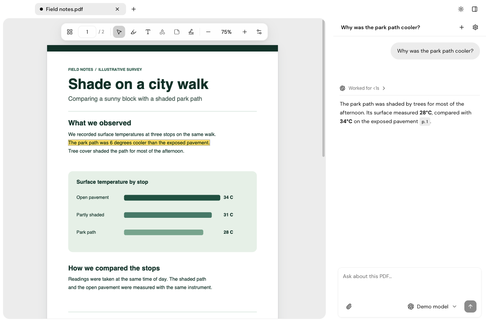

# Sunny

Sunny is a local-first PDF app for macOS. Read and annotate documents, organize pages,
and ask questions about a PDF in an optional side-by-side chat.

## Download

Sunny requires macOS 13 or later.

1. Open the [latest GitHub release](https://github.com/Bruno-Nicolo/sunny/releases/latest).
2. Download the `arm64.dmg` for Apple silicon or the `x64.dmg` for an Intel Mac.
3. Open the disk image and drag **Sunny** into **Applications**.

The first release uses an ad hoc signature and has no Apple notarization. If macOS blocks
it, verify that you downloaded it from the release above and follow
[Apple’s instructions for opening the app](https://support.apple.com/en-us/102445).

## Features

### Read and annotate

Open several PDFs in tabs, search within a document, and jump to pages using thumbnails
or the outline. Read two pages side by side or switch to full-screen presentation mode.
Highlight text or draw freehand, add editable text boxes and images, and draw or import
a visible signature for reuse. Sunny restores your tabs and keeps local recovery copies
of unsaved annotations.

### Organize and export pages

Select pages in the thumbnail grid and drag them into a new order, delete them, or
export the selection as a separate PDF. Preview page changes before saving them to
the original document.

- **Export without annotations** creates a clean copy with selectable text, links and form fields.
- **Export flattened PDF** embeds annotations in page images. The exported copy has no
  selectable text, clickable links or interactive form fields.

### Chat with a PDF

Ask about a passage, attach a figure or a selected region, or summarize a document.
Click a citation in an answer to jump to the corresponding passage. Connect an eligible
ChatGPT plan or use your own OpenAI, Anthropic, Gemini or OpenRouter API key.

PDF viewing and editing run on your Mac. When you send a chat request, your chosen
provider receives the prompt and relevant excerpts, attachments and conversation history.
Region attachments can include unsaved annotations. You can disable requests in AI settings.
See [how Sunny handles chat data](docs/ai-chat.md#data-flow-and-citations).

[User guide](docs/using-sunny.md) ·
[Report a bug](https://github.com/Bruno-Nicolo/sunny/issues/new/choose) ·
[Build from source or contribute](CONTRIBUTING.md) · [MIT License](LICENSE)
